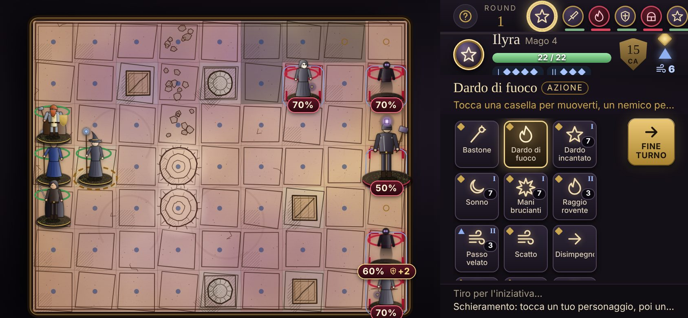
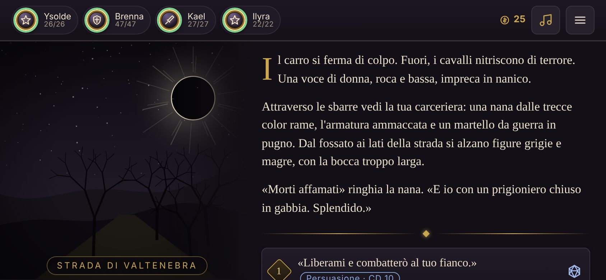
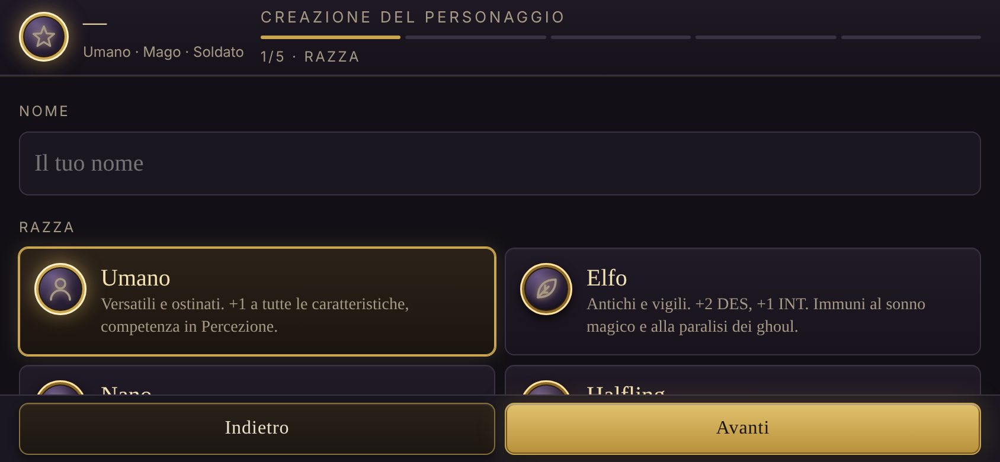
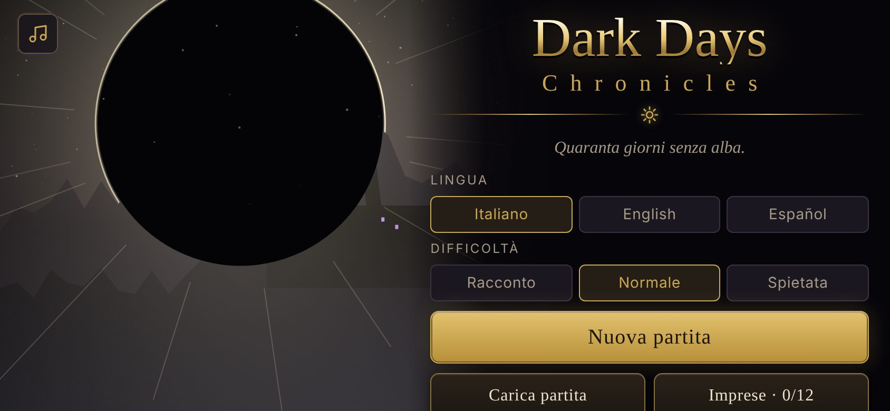

# Dark Days Chronicles

**Un gioco di ruolo a turni per smartphone Android, ispirato a Baldur's Gate, Icewind Dale e XCOM, con regole adattate da D&D 5ª edizione.**

Quaranta giorni senza alba. Sopra la valle di Valtenebra pende un disco nero orlato di fuoco pallido, e sulla tua mano è comparso un marchio che nessuno sa spiegare. Raduna un gruppo di compagni, fai scelte che cambiano la storia e affronta combattimenti tattici su mappe disegnate a inchiostro.



| Storia | Creazione del personaggio | Titolo |
|---|---|---|
|  |  |  |

## Scarica e gioca

- **Android (APK):** scarica l'ultima versione da
  [Releases → DarkDaysChronicles.apk](https://github.com/kain986/DarkDays-cronicles/releases/latest/download/DarkDaysChronicles.apk).
  Aprilo sul telefono e consenti l'installazione da questa fonte. Serve Android 8.0 o superiore.
- **Nel browser:** [kain986.github.io/DarkDays-cronicles](https://kain986.github.io/DarkDays-cronicles/)
  (va attivato una volta da *Settings → Pages → Branch `main`, cartella `/docs`*).

Il gioco funziona offline. Nell'app controlla da solo se è uscita una versione nuova (al massimo ogni 6 ore) e propone di scaricarla; dal titolo c'è anche il pulsante **Controlla aggiornamenti**.

> **Aggiornando dalla versione 2.0 o precedente:** le vecchie build erano firmate con una chiave diversa a ogni compilazione, quindi Android non permette di installarci sopra la nuova: va disinstallata la vecchia app una volta, e la partita salvata lì si perde (quelle versioni non avevano ancora l'esportazione). Da questa versione la firma è sempre la stessa: gli aggiornamenti si installano sopra conservando i salvataggi, e in più puoi copiare la partita come codice da **Menu → Opzioni → Salvataggi e codice**.

## Caratteristiche

- **Storia a capitoli.** Il *Capitolo I — Il Sole Nero* ha tre atti, un dungeon opzionale (le Volte di Aurel), 161 scene, compagni reclutabili e tre finali. La durata è di circa 5–6 ore. Gruppo, oggetti, livello e scelte passano ai capitoli successivi.
- **Tre lingue:** italiano, inglese e spagnolo, cambiabili in qualsiasi momento.
- **Creazione del personaggio in stile 5e:** 6 razze, 6 classi, background, acquisto a punti (27), abilità e competenze.
- **Prove di abilità con il d20**, vantaggio e svantaggio, tiri salvezza e classi difficoltà visibili.
- **Combattimento tattico a turni:**
  - griglia con copertura mezza (+2 CA) e tre quarti (+5 CA) data da rocce, alberi e rovine;
  - fiancheggiamento, attacchi di opportunità, Disimpegno, Guardia (overwatch), Spinta, Attacco poderoso;
  - reazioni, condizioni e incantesimi con slot.
  - Toccando un nemico vedi la probabilità di colpirlo; le caselle rischiose sono segnalate prima di muoverti.
  - Prima dello scontro puoi schierare il gruppo; durante lo scontro ci sono sfide facoltative che danno ricompense.
- **IA dei nemici "utility":** valuta ogni casella raggiungibile in base al danno atteso, alla copertura, al fiancheggiamento e al rischio di subire attacchi di opportunità o la Guardia.
- **Progressione alla Baldur's Gate:**
  - livelli fino al 7 nel Capitolo I, talenti, dadi vita, riposi brevi e lunghi;
  - oggetti magici, ninnoli, pergamene, negozi e bottino casuale.
- **Grafica e audio:**
  - mappe a inchiostro e pennino generate al volo e miniature dipinte;
  - effetti di particelle;
  - musica procedurale che cambia con l'atmosfera, ed effetti sonori.
- **Comodità:**
  - salvataggio automatico, 3 slot manuali, esportazione e importazione della partita come codice testuale;
  - bestiario, 12 imprese (obiettivi), dimensione del testo regolabile ed effetti ridotti;
  - modalità orizzontale (predefinita su telefono) oppure verticale o automatica.

## Struttura del repository

```
src/                      sorgenti del gioco (HTML/CSS/JS), concatenati in ordine
  00_shell.html           struttura della pagina e stili
  10_data.js              regole: razze, classi, incantesimi, oggetti, nemici, scontri
  15_chapters.js          registro dei capitoli
  30_engine.js            stato, scene, prove, riposi, livelli, menu
  40_combat_rules.js      regole di combattimento e IA dei nemici
  41_combat_ui.js         interfaccia ed effetti del combattimento
  50_ui_screens.js        titolo, creazione del personaggio, storia
  60_audio.js             musica ed effetti sonori procedurali
  70_maps_minis_cover.js  mappe a inchiostro, miniature, copertura
  71_tactics.js           schieramento, rischio di movimento, sfide
  72_landscape.js         modalità orizzontale
  80_meta.js              salvataggi, bestiario, obiettivi, opzioni, aggiornamenti
  99_boot.js              avvio
  chapters/ch1_il_sole_nero/   Capitolo I (definizione + tre atti)
tools/
  build.mjs               assembla il gioco nei tre file di uscita
  validate-story.mjs      controlla che ogni scena e ogni scelta portino da qualche parte
  simulate.mjs            simula la campagna con un gruppo-bot per verificare il bilanciamento
app/                      progetto Android (WebView)
docs/                     versione web (GitHub Pages), documentazione e screenshot
```

`app/src/main/assets/index.html` e `docs/index.html` sono **generati**: si modificano i file in `src/` e si ricompila.

## Compilare

Requisiti: Node.js 18 o superiore; per l'APK anche JDK 17 e Gradle 8.9 (oppure Android Studio).

```bash
node tools/build.mjs              # genera dist/, docs/index.html e l'asset Android
node tools/validate-story.mjs     # verifica la trama
node tools/simulate.mjs --quick   # verifica il bilanciamento (circa 3 secondi)
gradle assembleRelease            # APK in app/build/outputs/apk/release/
```

`node tools/build.mjs --inline-fonts` incorpora anche i caratteri tipografici nell'APK, così l'aspetto è identico offline (serve la connessione durante la compilazione).

`simulate.mjs` accetta `--runs N`, `--classes fighter,wizard`, `--diff 0|1|2` e `--verbose`. Fallisce se uno scontro viene vinto meno del 50% delle volte.

### Build automatica e rilasci

Il workflow [`.github/workflows/build-apk.yml`](.github/workflows/build-apk.yml) parte a ogni push su `main`. Esegue in ordine:

1. assemblaggio del gioco;
2. verifica della trama;
3. simulazione del bilanciamento;
4. compilazione dell'APK, caricato come artefatto.

Per pubblicare una versione:

1. aggiorna `versionCode` e `versionName` in `app/build.gradle.kts`;
2. aggiungi la sezione `## X.Y — data` in [CHANGELOG.md](CHANGELOG.md);
3. fai il push su `main`.

Se la release `vX.Y` non esiste ancora, il workflow la crea con l'APK allegato e usa la sezione del CHANGELOG come note di rilascio. In alternativa puoi pubblicare un tag `vX.Y`. Il gioco installato vede la nuova release tramite l'API di GitHub e la propone ai giocatori.

### Firma

L'APK è firmato con `app/release.keystore`. La chiave è inclusa nel repository di proposito, così ogni build (locale o in CI) ha la stessa firma e gli aggiornamenti si installano sopra la versione precedente. Va bene per un progetto amatoriale distribuito tramite GitHub. Per pubblicare sul Play Store serve una chiave privata tenuta fuori dal repository (in un *secret* di GitHub) e un App Bundle (`.aab`).

## Aggiungere un capitolo

Vedi [docs/DEVELOPMENT.md](docs/DEVELOPMENT.md). In breve:

1. crea `src/chapters/ch2_<nome>/00_chapter.js` con `defineChapter({...})` e la scena iniziale;
2. aggiungi i file degli atti;
3. ricompila.

Le partite che hanno finito il Capitolo I trovano il nuovo capitolo da **Continua** o da **Capitoli**.

## Documentazione

- [docs/GAME_DESIGN.md](docs/GAME_DESIGN.md): regole, combattimento, progressione, struttura della storia.
- [docs/DEVELOPMENT.md](docs/DEVELOPMENT.md): formato delle scene, scontri, oggetti, capitoli, test.
- [CHANGELOG.md](CHANGELOG.md): cronologia delle versioni.

## Crediti

- Ideazione e direzione: **kain986**. Sviluppo realizzato con l'assistenza di Claude (Anthropic).
- Regole ispirate al *System Reference Document 5.1* di D&D 5ª edizione (Wizards of the Coast, licenza CC-BY-4.0). Dark Days Chronicles non è affiliato a Wizards of the Coast.
- Caratteri tipografici: Alegreya, Alegreya Sans e IM Fell English SC (SIL Open Font License), tramite Google Fonts.
- Musica, effetti sonori, mappe e miniature sono generati dal codice: non ci sono asset di terze parti.

## Licenza

Non ancora scelta. Finché non viene aggiunto un file `LICENSE`, tutti i diritti restano all'autore.
